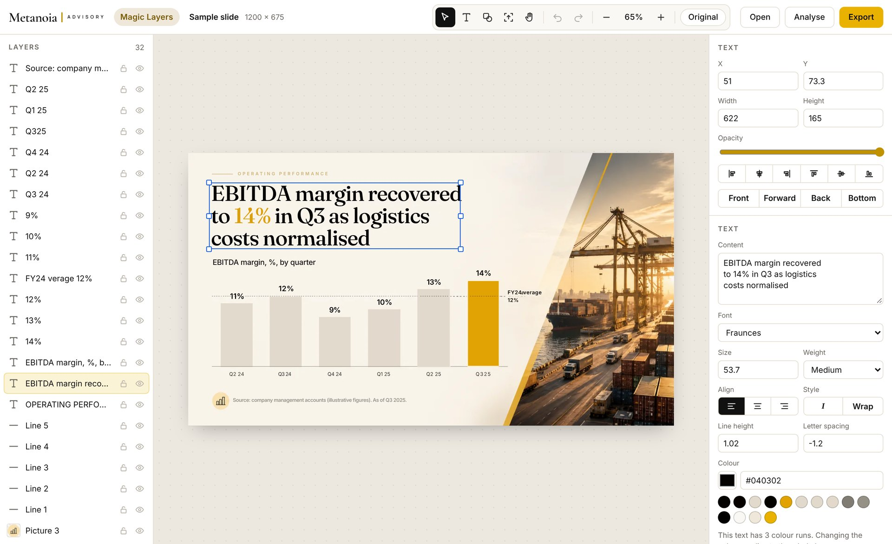
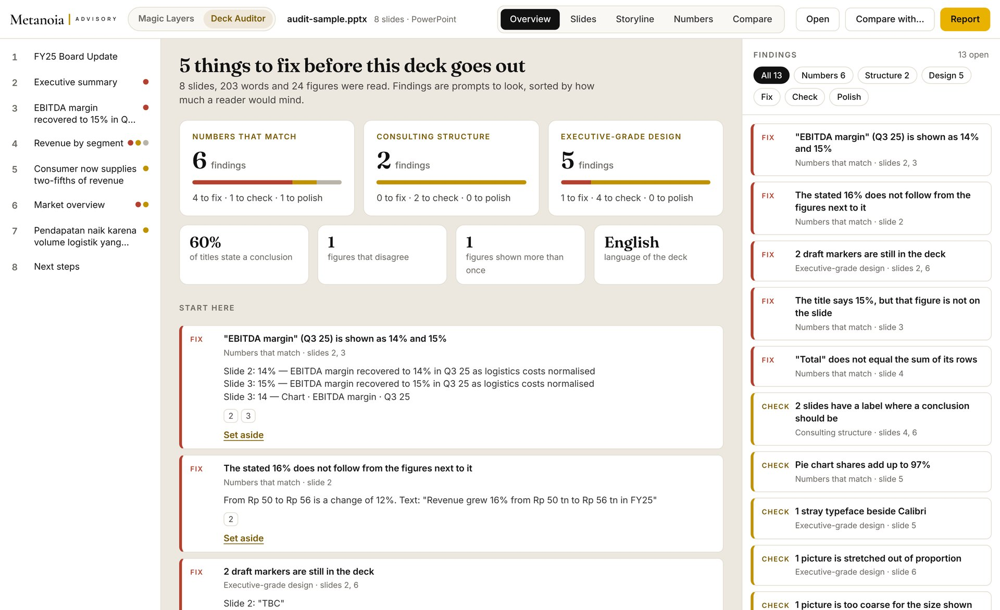

# Magic Layers and Deck Auditor

Two desktop tools for Metanoia Advisory's Strategic Storytelling & Corporate Communications work, in one app that runs on your computer. Files are not uploaded anywhere.

- **Magic Layers** takes a flattened slide (a screenshot, an exported image, a PDF page, a PowerPoint made of pictures) and separates it into editable layers: live text boxes, shapes, lines and pictures on a repaired background. The result is edited in the app or exported as a normal, editable PowerPoint.
- **Deck Auditor** reads a finished PowerPoint or PDF and checks it against the firm's three promises before it goes out: consulting structure, executive-grade design, numbers that match. It also compares two versions of a deck and writes the change log.

Switch between them with the two tabs at the top left.

## Start it

You need Node.js (free, any version from 18 up). If it is not installed, get the LTS version from https://nodejs.org.

| Computer | How to start |
| --- | --- |
| Windows | Double-click `start.bat` |
| macOS | Double-click `start.command` (the first time: right-click, Open, to get past Gatekeeper) |
| Linux | Run `./start.sh` |

The app opens in your browser at http://localhost:4517. Keep the small terminal window open while you work; close it to stop the app. Use a current Chrome or Edge (Firefox should work too).

If you received the app as a zip file, everything it needs is inside and it works offline from the first start. If you took it from the repository instead, the first start downloads its libraries once (about a minute); after that it works offline.

## Use it

1. **Open** a file: drag it onto the window, press Open, or paste an image from the clipboard. "Try the sample slide" shows the idea in ten seconds.
2. **Layers are created** automatically for the first page (5 to 10 seconds for a slide). For a deck, press "Analyse all" above the page list, or do pages one at a time.
3. **Edit**: click to select, drag to move, drag a handle to resize, double-click text to rewrite it. The panel on the right changes font, size, weight, colour, alignment, spacing, corner radius and order. The list on the left hides, locks, renames and reorders layers.
4. **Export** (top right): PowerPoint with live text boxes, native shapes and pictures; a layered Photoshop file; SVG; PNG; or a project file (`.mlayers`) to continue later.

### What it reads

| Input | What happens |
| --- | --- |
| PNG, JPG, WebP, GIF, BMP | Text is read by OCR (English, Indonesian, or both) and rebuilt in the closest typeface on your computer |
| PDF, any number of pages | The PDF's own text is used, so wording and sizes are exact; only the typeface is matched |
| PPTX whose slides are pictures | Each picture slide becomes a page; export returns an editable deck |
| `.mlayers` | A saved Magic Layers project |

### Tools

| Tool | Key | Use |
| --- | --- | --- |
| Select | V | Select, move, resize. Shift-click or drag a rectangle to select several. Alt while dragging switches snapping off |
| Text | T | Click to add a text box in the slide's own style |
| Lift | L | Drag a rectangle around anything still stuck in the background or in a picture; it becomes its own layer and the gap behind it is repaired |
| Hand | H or Space | Move around. Ctrl + wheel zooms |
| Original | hold `\` | Compare with the file as it came in |

Other shortcuts: arrows nudge (Shift: 10 px), Ctrl+Z / Ctrl+Y undo and redo, Ctrl+D duplicate, Delete removes, `[` and `]` change the order, Enter edits the selected text, Ctrl+S saves the project, Ctrl+E exports PowerPoint.

### Getting the best result

- **The Analyse menu** sets the text language, the level of detail (Simple gives fewer, larger layers; Detailed pulls out small elements) and a slower, more thorough text search for dense slides.
- **A logo or icon was turned into text?** Select it and choose "Convert back to picture".
- **Something was left in the background?** Use the Lift tool.
- **Typefaces.** Text is matched against the firm's fonts (Fraunces, Inter, Cormorant Garamond, Manrope are built in) and the fonts installed on your computer. "Apply brand fonts" in the right panel resets a whole page to the house typefaces in one click.
- **PowerPoint fonts.** PowerPoint uses the fonts installed on the computer that opens the file. Install Fraunces and Inter (free from Google Fonts) to see the deck as designed, or choose "PowerPoint with Office fonts" when the file goes to someone without them.
- **Higher resolution reads better.** A slide exported at 1920 px or wider gives cleaner text than a small screenshot.

## Deck Auditor

Open a `.pptx` (full audit) or a PDF (wording, figures and titles), or press "Try the sample deck" to see a deck with known flaws being caught. Nothing needs to be configured.

| Pillar | What is checked |
| --- | --- |
| Numbers that match | The same metric and period shown with different values on different slides, in text, tables or chart data. Table totals and total columns that do not equal the sum of their parts. Shares and pie charts that do not make 100%. A growth rate that does not follow from the two figures next to it. A figure in a title that is not in the chart or table below it. Data slides without a source line. English and Indonesian number formats (1,250.5 and 1.250,5) are both understood |
| Consulting structure | Titles that name a topic instead of stating a conclusion; missing, duplicated and over-long titles; no executive summary near the front; no page that states the decision or next steps; slides with more than 150 words; a slide in the other language |
| Executive-grade design | Draft markers left in (TBC, Lorem ipsum, xx%, [brackets]); stray typefaces; title size and position that change from slide to slide; pictures stretched out of proportion or too coarse for their size; text below 9 pt; content past the slide edge; text breaking the left margin; empty placeholders; missing page numbers |

How to work with it:

- **Findings** are on the right, sorted Fix, Check, Polish. Click one for the detail and the slide numbers; click a slide number to see the slide with the area outlined. "Set aside" removes a finding you have judged not to be an issue; it leaves the report.
- **Storyline** lists every title in order with a verdict, which is the "read the titles alone" test. "Copy the titles" puts them on the clipboard.
- **Numbers** is a ledger of every figure that appears more than once, disagreements first, with a search box.
- **Compare with…** opens the previous version of the deck. Slides are paired even when pages were added, removed or moved; every change to wording and figures is shown, and "Copy the change log" gives a text version to send to the client.
- **Report** saves a one-page audit report (open it and print to PDF), the findings as a spreadsheet, or the change log.
- Tick "This is a Metanoia deck" on the Overview to flag every typeface other than the house fonts.

What to keep in mind:

- The checks find patterns, not meaning. Figures are matched by the words around them, so now and then two different metrics are paired, or the same metric worded differently on two slides is missed. A finding is a prompt to look; a clean report does not replace a read-through.
- A chart pasted as a picture has no data to read. Run such slides through Magic Layers first, or audit the source file.
- The slide preview is a layout sketch built from the file (text, tables, pictures, chart data). It is for locating a finding, not for judging the design. PDFs are shown exactly.
- A PDF has no placeholders, tables or chart data, so totals, chart figures and typefaces are checked only in the PowerPoint file. Portrait PDFs are read as reports and the slide rules for density and type size are skipped.
- Old `.ppt` files must be saved as `.pptx` first.

## Brand kit

`app/brand.json` holds the house typefaces and colour swatches shown in the editor. Edit it to add colours or to change the heading and body typefaces.

## AI assist (optional)

Everything above works offline with no account. If you add an Anthropic API key, an "AI assist" button appears: Claude looks at the slide, corrects misread words, recovers text the local pass missed and gives the layers meaningful names.

1. Run `npm install` once in this folder (if you have not already).
2. Copy `.env.example` to `.env` and paste the key after `ANTHROPIC_API_KEY=`.
3. Restart the app.

With AI assist, the image of the slide you run it on is sent to the Anthropic API. The same key switches on "Review the storyline with AI" in the Deck Auditor, which sends the deck's titles and slide text (not pictures) for a partner-style comment on the argument. Nothing is sent when you do not use these buttons. For confidential client material, leave them alone.

## How it compares with Canva's Magic Layers

Canva announced Magic Layers in March 2026 as a cloud feature that turns a single flat PNG or JPG into an editable Canva design, with text restored as text boxes. This tool follows the same idea and goes further where the firm's work needs it:

| | Canva Magic Layers (as announced) | This tool |
| --- | --- | --- |
| Where files go | Uploaded to Canva | Stay on your computer |
| Input | One PNG or JPG | Images, multi-page PDF, picture-slide PowerPoint |
| Text from PDFs | n/a | Exact, from the file |
| Output | A Canva design | Editable PowerPoint, layered PSD, SVG, PNG, project file |
| Languages | Not stated | English and Indonesian OCR built in |
| Brand | Canva brand kit | One-click house typefaces, house colours |
| Cost | Canva plan and AI allowance | None (AI assist optional, pay per use) |

Where Canva is stronger: it uses large generative models, so it can rebuild complex artwork behind objects and separate overlapping photographic elements. This tool repairs backgrounds by filling from the surroundings, which is clean on flat, gradient and lightly textured backgrounds and visibly soft on busy photographs.

## Limits to know

- OCR is not perfect. Small or low-contrast text, text inside photographs, and unusual display faces can be misread; check wording before a deck goes out. PDFs do not have this problem.
- Typeface matching chooses among fonts on your computer. If the original face is not installed, the closest one is used and the text may be a little wider or narrower.
- Charts become shapes and text, not live PowerPoint charts.
- Rotated text and text along curves stay in the picture.
- Very large pages are worked on at 2,400 px on the long side.

## Checking that it works

`npm test` starts the app on a spare port, checks that it serves correctly and runs the Deck Auditor's number and title rules. When Playwright is available it also drives the real app: it separates the sample slide, a picture deck and an eight-page PDF, edits, and verifies every export; then it audits a sample deck with thirteen planted flaws, expects exactly those thirteen findings, and compares it with its previous version.

## Files

| Path | What it is |
| --- | --- |
| `start.bat`, `start.command`, `start.sh` | Launchers |
| `server.mjs` | Local server (answers only to this computer) |
| `ai-assist.mjs`, `ai-storyline.mjs` | Optional AI endpoints (Magic Layers text check, Deck Auditor storyline review) |
| `app/auditor.html`, `app/js/audit/` | The Deck Auditor: PowerPoint and PDF readers, the checks, version compare, report |
| `app/` | The application: interface, analysis worker, importers, exporters |
| `app/vendor/` | Bundled libraries: Tesseract OCR with English and Indonesian data, pdf.js, PptxGenJS, JSZip, ag-psd |
| `app/brand.json` | House typefaces and colours |
| `test/` | Self-test and sample files |

Trouble starting: "Port 4517 is used by another program" means something else has the port; start with another one (`PORT=4600 node server.mjs`, on Windows `set PORT=4600 && node server.mjs`). If the browser shows a blank page, check the terminal window for a message and that the browser is up to date.
